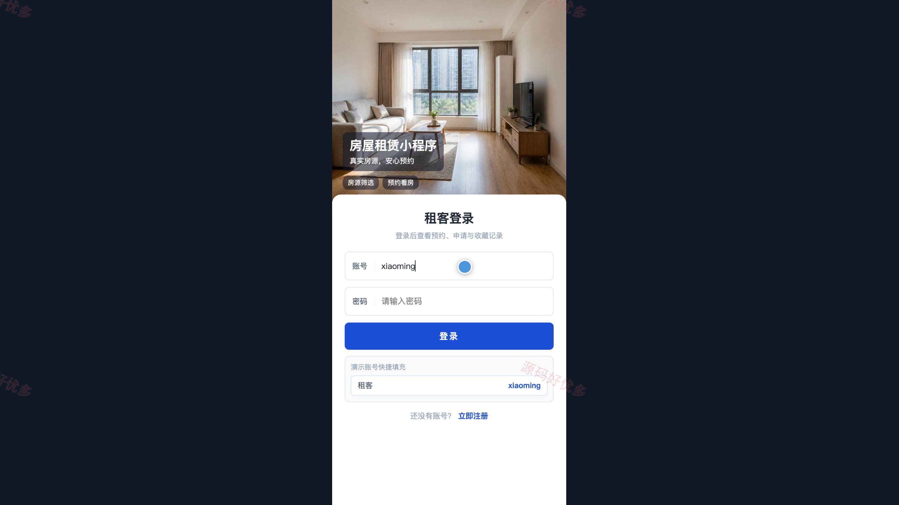
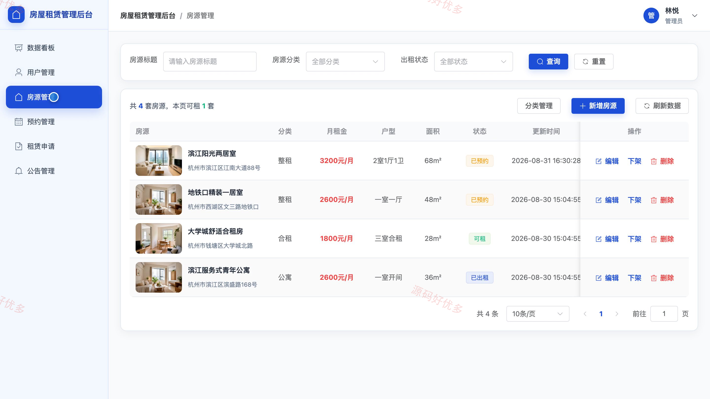

# bs047B
bs047B房屋租赁小程序源码 Java SpringBoot3 Vue3 设计文档 PPT
## 源码问题查看主页咨询

### 一、关键词
房屋租赁、租房服务、房源预约、短租找房、住房出租

### 二、作品包含
源码+数据库+万字设计文档+PPT+全套环境和工具资源+本地部署教程

### 三、项目技术
前端技术： Html、Css、Js、Vue3.4、Element-Plus、uniapp
后端技术：Java、SpringBoot3.3.5

### 四、运行环境要求
开发工具：IDEA/eclipse + VSCODE + HBuilder X + 微信开发者工具

数据库：MySQL5.7+（共7张表）

数据库管理工具：Navicat10以上版本

环境配置软件： JDK17 + Maven3.6

前端Nodejs：16+

浏览器：谷歌浏览器

### 五、项目介绍
项目编号：bs047B

房屋租赁小程序面向租客和管理员，支持房源查询收藏、预约看房、租赁申请与进度跟踪，并提供用户、房源、预约、租赁审核和公告等后台管理能力。

角色：租客、管理员

租客功能：注册登录、房源浏览与筛选、房源收藏、预约看房与进度查询、租赁申请与审核进度查询、个人资料维护、密码修改。

管理员功能：数据看板、用户管理、房源分类管理、房源管理、预约管理、租赁审核、公告管理、个人资料与密码维护。

### 六、运行截图

